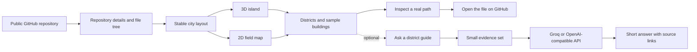

<div align="center">

# RepoLens

### Step inside a codeworld.

Turn a public GitHub repository into a living pixel city. Wander its districts, open real files, and ask friendly guides what the code does.

[](https://repolens-beige.vercel.app/)

<br />


<br />


</div>

## A map you can walk through

Paste a public GitHub repository URL and RepoLens builds an explorable island from its real folder tree. The city is a playful way to get your bearings: every district and file still leads back to the actual repository.

| In the repository | In RepoLens | Explore it |
| --- | --- | --- |
| Top-level folders | City districts | Compare their size and role |
| Sampled file paths | Clickable buildings | Inspect a path or open it on GitHub |
| Source, test, docs, and config folders | Distinct district colors and guides | Ask a local spirit for a plain-language explanation |
| Languages and repository details | A field journal | Read the language chart and project notes |

The 3D city fills the screen. Taxis move through the street grid, residents stroll around the commons, clouds drift above the island, and a small harbor boat traces the shore. RepoLens respects your reduced-motion setting. A 2D field map is available at any time, and also serves as a fallback when WebGL is unavailable.

### Take a first walk

1. Open the [live demo](https://repolens-beige.vercel.app/).
2. Paste a public repository URL, or choose one of the sample worlds.
3. Drag to turn the island, scroll to zoom, and select a district or building.
4. Open a real file on GitHub, browse the journal, or talk to the district guide.

The city represents a bounded sample of file paths, not a separate copy of the code. RepoLens shows the repository's returned totals and calls out when GitHub truncates a file tree.

## Meet the guides

Each district has a small character guide with its own voice. Replies stay brief, explain things in everyday language, and link to the files used as evidence.

| Guide | Usually found around | Style |
| --- | --- | --- |
| **Patch the Maker** | Source code | Traces how the pieces fit together |
| **Vera the Verifier** | Tests | Explains what a test is written to check |
| **Page the Archivist** | Documentation | Finds the signposts and setup steps |
| **Wrench the Builder** | Configuration and scripts | Makes build settings easier to understand |
| **Moss the Pathfinder** | Other folders | Helps choose a useful next stop |

AI is optional. The island, file map, inspector, journal, and GitHub links work without an AI key. When a guide is used, RepoLens sends the selected question, relevant repository context, and up to three small files from that district to the configured AI provider. RepoLens does not save conversations.

## Run it locally

You need **Node.js 20.19 or newer**.

```bash
git clone https://github.com/HemantKumar822/RepoLens.git
cd RepoLens
npm install
npm run dev
```

Open [http://localhost:5173](http://localhost:5173). The dev command starts the Node API and Vite together; Vite forwards `/api` requests to the local server.

### Enable the AI guides

Copy `.env.example` to `.env`, then add a Groq key:

```dotenv
GROQ_API_KEY=your_groq_api_key
```

`GROQ_MODEL` is optional and defaults to `openai/gpt-oss-20b` for faster guide replies. An OpenAI-compatible provider can be used with `OPENAI_API_KEY`; `OPENAI_MODEL` and `OPENAI_BASE_URL` are optional settings. Keep provider keys on the server and out of Git.

### Build and serve

```bash
npm test
npm run build
npm start
```

The test command checks the city traffic route selection. The build checks TypeScript and writes the static site to `dist`. `npm start` serves that build with the local API routes.

## Deploy on Vercel

Import the repository into Vercel. The included `vercel.json` configures the Vite build and output directory. Add `GROQ_API_KEY` in the project’s **Environment Variables** settings for Production, and Preview if you want AI guides in preview deployments. Redeploy after saving the key.

The key is used only by server-side functions. Do not prefix it with `NEXT_PUBLIC_` or add it to client code. The rest of the experience works when the key is unset.

## How the world works



RepoLens uses GitHub's public API for repository metadata, languages, README text, and the file tree. Folder names and path patterns provide simple role clues; they do not claim to measure code quality. The layout is repeatable for the same repository, while different folder structures create different cities.

## Built with

- **React, TypeScript, and Vite** for the interface and development workflow
- **Three.js, React Three Fiber, and Drei** for the full-screen island and interactive scene
- **Node.js and Vercel Functions** for GitHub analysis and optional server-side AI
- **GitHub REST API** for public repository metadata and file paths
- **Groq** by default for AI guides, with an optional OpenAI-compatible provider

The bundled low-poly city models are from [Kit Cidade Low Poly](https://github.com/kayquer/kit-cidade-lowpoly) and are dedicated to the public domain under CC0 1.0. See the [asset notes](public/assets/city/ASSET_SOURCES.md) and [license text](public/assets/city/CC0-1.0.txt). The landscape and characters are original RepoLens artwork; city assets are bundled locally, so the scene does not fetch models from third-party hosts.

## Project map

```text
src/
  components/hud/   Title screen, map, journal, file inspector, and guides
  data/spirits.ts   Guide names, roles, and personalities
  lib/              GitHub-facing client helpers
  world/            City layout, landmarks, and Three.js scene
  styles/           Island and HUD styling
api/                Vercel handlers for repository analysis and AI tours
server.mjs          Local API server used during development
public/assets/city/ Bundled low-poly city models and their credits
docs/plans/         Design history; see its README for context
```

## Notes

- RepoLens currently maps **public repositories**; no GitHub sign-in or token is needed.
- Buildings are representative samples of real paths. Large repositories do not create one 3D object per file.
- If GitHub returns a truncated tree, the app labels the counts as based on the paths GitHub returned.
- Guide roles come from folder names and path signals. The guide's personality changes its tone, not the underlying evidence.
- The [design notes](docs/plans/README.md) preserve earlier planning decisions; use this README and the current source code for shipped behavior.
